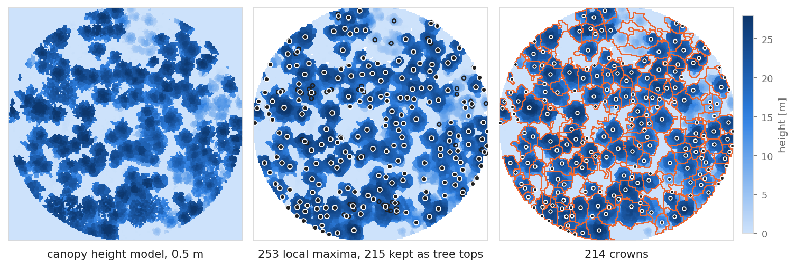

<h1></h1>

[](https://github.com/igorpawelec/cacumen/actions/workflows/python-tests.yml)
[](https://github.com/igorpawelec/cacumen/actions/workflows/R-CMD-check.yaml)
[](https://github.com/igorpawelec/cacumen/actions/workflows/parity.yml)
[](LICENSE)

**Individual tree crown delineation from canopy height models, by Hierarchical Region Growing.**

A canopy height model goes in; a crown per tree comes out, as a label raster and as polygons. One algorithm, two packages in this repository:

| | Package | Latest | Install |
|---|---|---|---|
| Python | [`pycacumen`](python/) |  | `pip install --no-deps "git+https://github.com/igorpawelec/cacumen.git#subdirectory=python"` |
| R | [`rcacumen`](r/) |  | `remotes::install_github("igorpawelec/cacumen", subdir = "r")` |

The two are checked against each other whenever either changes ([parity workflow](.github/workflows/parity.yml)). On the shared synthetic test suite they produce identical output, pixel for pixel, on the sixty small scenes and differ on 0.032 % of pixels on the ten large, crowded ones. On real canopy height models they agree to within 0.25 % of watershed pixels, because the two watershed implementations break plateau ties differently.

**Authors:** Igor Pawelec, University of Agriculture in Kraków. **License:** GPL-3.0.

## The problem it solves

Every crown delineation that starts from a canopy height model meets the same obstacle: **tree tops are over-detected**. The upper surface of a broad crown is ragged, so a local-maximum detector finds several peaks on it. The usual remedy is to smooth harder or to raise the detection threshold, and both trade one error for another: the surplus peaks disappear together with the small, suppressed trees that were real.

cacumen does not try to get the tops right first. It accepts the surplus and corrects it afterwards, in the growing itself:

1. **Watershed.** Every tree top seeds a marker-based watershed on the inverted CHM, so there is exactly one region per top — the regions *are* the detected trees.
2. **Region adjacency graph.** Neighbouring regions are joined by a weighted edge, *w(a,b) = α·|Δμ| + β·|Δσ| + γ/(border+1)*, and the region statistics come from the same single pixel pass.
3. **Growing.** Each tree grows greedily, absorbing neighbours while the combined height variance stays under a threshold. When two trees absorb each other, they were one crown — this is where over-detection is undone.
4. **Arbitration.** Growing runs independently per seed, so two crowns can claim the same region. The claim is settled on the data — the taller tree, the nearer tree, or the better height match — never on iteration order, so the result does not depend on how the tops were sorted.



*A 100 × 100 m tile of a 0.5 m canopy height model (`python/test_data/chm_150_2014.tif`, a mature stand on a circular sample plot). Left: the input. Middle: 253 local maxima after median smoothing (`hmin` 7 m, 5 px window), of which 213 survive merging within 5 px and screening below 10 m — the filled markers. Right: the 212 crowns grown from them at the default `variance_thresh` of 2. Made by `www/figures.py`.*

## Quick start

Python, with the native dependencies from conda ([details](python/README.md#installation)):

```python
from pycacumen import CrownDelineator

cd = CrownDelineator.from_file("chm.tif")
cd.smooth(ws=3).detect(hmin=7, ws=5).merge(5.0).screen(10.0)
crowns = cd.delineate(variance_thresh=2.0)

cd.to_raster("crowns.tif")
cd.to_vector("out/", name="crowns")
```

R, with a C compiler and optionally `terra` ([details](r/README.md#installation)):

```r
library(rcacumen)

res <- delineate("chm.tif",
                 smooth_ws      = 3,
                 hmin           = 7,
                 detect_ws      = 5,
                 merge_distance = 5,
                 screen_hmin    = 10,
                 variance_thresh = 2)

res$crowns        # SpatRaster of crown ids, 0 = background
res$tops          # tree tops actually used
res$n_contested   # regions claimed by more than one crown

write_crowns(res$crowns, "crowns.tif")
terra::plot(crowns_to_polygons(res$crowns))
```

The parameters, the conflict rules and the measured agreement between the two packages are documented in each package's README: [python/README.md](python/README.md), [r/README.md](r/README.md).

## What is where

| Path | Content |
|---|---|
| [`python/`](python/) | `pycacumen`: the package, its tests, examples and changelog |
| [`r/`](r/) | `rcacumen`: the package, its C sources, tests, `NEWS.md` and the tools that compare it with `pycacumen` |
| [`.github/workflows/`](.github/workflows/) | `python-tests`, `R-CMD-check` and `parity`, each run only for the folders it covers |

## Releases

Each package is versioned and tagged on its own: `python-vX.Y.Z` and `r-vX.Y.Z`. The tags up to `python-v0.6.0` and `r-v0.5.0` were carried over, with the full history, from the two repositories the packages used to live in, `pycacumen` and `rcacumen`.

## Citation

Each package carries its own citation metadata: [python/CITATION.cff](python/CITATION.cff) and [r/CITATION.cff](r/CITATION.cff). The works the method builds on are listed in the [Citation section of the Python README](python/README.md#citation).

## Licence

GNU General Public License v3.0, see [LICENSE](LICENSE). cacumen derives from PyCrown (Zörner et al. 2018, https://doi.org/10.7931/M0SR-DN55), which is published under GPLv3; the licence carries over.
