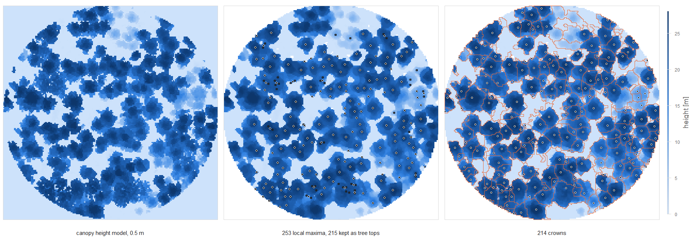
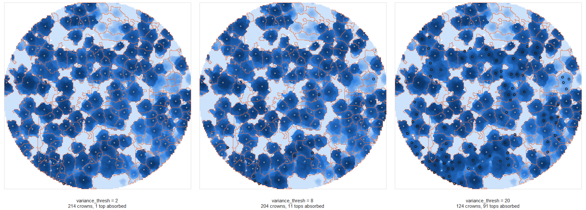

# rcacumen


[](https://github.com/igorpawelec/cacumen/actions/workflows/R-CMD-check.yaml)
[](https://github.com/igorpawelec/cacumen/releases)
[](LICENSE)
[](https://www.r-project.org)

**Individual tree crown delineation from canopy height models, by Hierarchical Region Growing.**

A canopy height model goes in; a crown per tree comes out, as a raster of ids and as polygons. R and plain C — no Rcpp, no compiled dependencies, and `terra` only if you want to read and write files.

> **Python users:** the same algorithm is in [`python/`](../python), the pycacumen package. The two packages share this repository, and they are not merely similar. On the seventy scenes of the shared synthetic test suite they produce **identical output, pixel for pixel**. On real canopy height models they agree closely but not exactly, because the two watershed implementations break plateau ties differently. Both numbers are measured, not claimed — see [Agreement with pycacumen](#agreement-with-pycacumen).

## The problem it solves

Every crown delineation that starts from a canopy height model meets the same obstacle: **tree tops are over-detected**. The upper surface of a broad crown is ragged, so a local-maximum detector finds several peaks on it. The usual remedy is to smooth harder or to raise the detection threshold, and both trade one error for another: the surplus peaks disappear together with the small, suppressed trees that were real.

rcacumen does not try to get the tops right first. It accepts the surplus and corrects it afterwards, in the growing itself:

1. **Watershed.** Every tree top seeds a marker-based watershed on the inverted CHM, so there is exactly one region per top — the regions *are* the detected trees.
2. **Region adjacency graph.** Neighbouring regions are joined by a weighted edge, *w(a,b) = α·|Δμ| + β·|Δσ| + γ/(border+1)*, and the region statistics come from the same single pixel pass.
3. **Growing.** Each tree grows greedily, absorbing neighbours while the combined height variance stays under a threshold. When two trees absorb each other, they were one crown — this is where over-detection is undone.
4. **Arbitration.** Growing runs independently per seed, so two crowns can claim the same region. The claim is settled on the data — the taller tree, the nearer tree, or the better height match — never on iteration order. Only an exact tie, two equally tall trees under the height rule for one, falls to the top that comes first, and both packages list the tops in one order.



*A 100 × 100 m tile of a 0.5 m canopy height model (`test_data/chm_150_2014.tif`, a mature stand on a circular sample plot). Left: the input. Middle: 253 local maxima after median smoothing (`hmin` 7 m, 5 px window), of which 215 survive merging within 5 px and screening below 10 m — the filled markers. Right: the 214 crowns grown from them at the default `variance_thresh` of 2. Made by `www/figures.R`, from this package.*

## The one parameter that matters

`variance_thresh` is the height variance (σ², in m²) a single crown may contain. It sets how readily a tree absorbs its neighbours, and therefore how many of the surplus tops are merged back. Everything else has a sensible default; this one you choose per stand.



*The same 215 tree tops grown at `variance_thresh` 2, 8 and 20. Filled markers are tops that ended up as a crown of their own; hollow rings are tops absorbed into a neighbour — 1, 11 and 91 of them. At 2 almost nothing merges and every peak on a broad crown stays a separate tree; at 20 the merging reaches across real crown boundaries in the dense south-east of the plot. The right value lies where the absorbed tops are the ragged-surface duplicates and not the suppressed neighbours, which is a judgement made by looking, and the point of drawing them. pycacumen's README shows the same tile from Python: identical at 2 and 20, one crown apart at 8 (205 against 204) — the watershed tie-breaking measured [below](#agreement-with-pycacumen), at work.*

Two further controls shape the outcome:

- **`conflict_rule`** decides who gets contested canopy: the taller tree (`"height"`, the default — dominant trees overtop their neighbours), the nearer seed (`"distance"`, classic ITC behaviour, splits rather than merges) or the better height match (`"similarity"`).
- **`protect_seeds = TRUE`** switches merging off entirely: every top keeps its crown. Use it when the tops are trusted, for instance field-measured stem positions.

The number of regions claimed by more than one crown is reported after every run (`attr(crowns, "n_contested")`, or `res$n_contested`); it grows with the threshold and is the quickest sign that a setting is too loose.

## When to use it, and when not

Use rcacumen when you have a canopy height model — from ALS, from photogrammetric point clouds, at any resolution around 0.25–1 m — and want one crown per tree with a defensible answer to over-detection. Bring your own tree tops if you have better ones; the growing works from any set of seeds.

Do not reach for it when you need Dalponte & Coomes delineation, or want to work on the point cloud directly: [lidR](https://github.com/r-lidar/lidR) and [itcSegment](https://cran.r-project.org/package=itcSegment) do that well in R, and rcacumen deliberately does not duplicate them.

The pipeline shape — smooth the CHM, find tops as local maxima, delineate crowns — comes from [PyCrown](https://github.com/manaakiwhenua/pycrown) (Zörner et al. 2018), via pycacumen; hierarchical region growing is the only delineation here.

### The package family

rcacumen is one step of a longer chain; the other steps are separate packages, each with an R and a Python twin.

| Step | R | Python |
|---|---|---|
| Colour-space conversion of orthophotos | [rgeopalette](https://github.com/igorpawelec/geopalette) | [pygeopalette](https://github.com/igorpawelec/geopalette) |
| Adaptive superpixels and seeded growing on orthophotos | [rgeoadaptels](https://github.com/igorpawelec/geosegments) | [pygeoadaptels](https://github.com/igorpawelec/geosegments) |
| Crowns from a canopy height model | **rcacumen** | [pycacumen](../python) |
| Standing dead trees on orthophotos | — | [pygeosnag](https://github.com/igorpawelec/geosnag) |
| The same, inside QGIS | | [qgis-geoadaptels-geopalette](https://github.com/igorpawelec/geosegments), [qgis-geosnag](https://github.com/igorpawelec/geosnag) |
| Polish national geodata (GUGiK, BDL) | [rgeopl](https://github.com/igorpawelec/geopl) | — |

## Installation

```r
# install.packages("remotes")
remotes::install_github("igorpawelec/cacumen", subdir = "r")
```

A C compiler is needed, which R already requires on Linux and macOS; on Windows install [Rtools](https://cran.r-project.org/bin/windows/Rtools/).

`terra` is optional and only used to read and write rasters:

```r
install.packages("terra")
```

## Quick start

```r
library(rcacumen)

res <- delineate("chm.tif",
                 smooth_ws      = 3,
                 hmin           = 7,
                 detect_ws      = 5,
                 merge_distance = 5,
                 screen_hmin    = 10,
                 variance_thresh = 2)

res$crowns        # SpatRaster of crown ids, 0 = background
res$tops          # tree tops actually used
res$n_contested   # regions claimed by more than one crown

write_crowns(res$crowns, "crowns.tif")
terra::plot(crowns_to_polygons(res$crowns))
```

### Matrices, without touching the disk

Every stage is a plain function, and none of the algorithm needs `terra`:

```r
sm   <- smooth_chm(chm, ws = 3, method = "median")
tops <- detect_tops(sm, hmin = 7, ws = 5)      # (n, 2) subpixel row/col
tops <- merge_tops(tops, distance = 5)

crowns <- grow_crowns(sm, as_pixels(tops), variance_thresh = 2)
attr(crowns, "n_contested")
```

## Reference

### Parameters

**Smoothing** — `smooth_chm(chm, ws, method)`

| Parameter | Default | Description |
|---|---|---|
| `ws` | 3 | Window size (px). Larger = fewer false tops, but merges close crowns |
| `method` | `"median"` | `median`, `mean`, `gaussian`, `maximum`. Median keeps crown edges sharp |

**Tree tops** — `detect_tops`, `merge_tops`, `screen_tops`

| Parameter | Default | Description |
|---|---|---|
| `hmin` | 2 | Minimum height (m) for a pixel to be a candidate |
| `ws` | 3 | Local-maximum window (px) = minimum spacing between tops |
| `distance` | 5 | Merge radius (px). Grouping is transitive — keep below crown diameter and below the spacing of the detected tops; a warning says when chains of tops longer than five times it were merged |
| `chm`, `hmin` | `NULL` | `merge_tops()` only: the CHM and the height the tops were detected above. With them, a group whose centroid falls on a cell with no data, or on one not above `hmin`, is represented by its highest top; `delineate()` passes both |

**Growing** — `grow_crowns`

| Parameter | Default | Description |
|---|---|---|
| `variance_thresh` | 2 | Max height variance within a crown. **The main lever** |
| `mask_thresh` | 0 | Minimum CHM height treated as canopy (m) |
| `morpho_radius` | 0 | Radius for opening/closing the mask. 0 = off |
| `alpha`, `beta`, `gamma` | 1, 0.5, 0.1 | Edge weights: mean diff, σ diff, inverse border length |
| `anneal_lambda` | 1 | Per-iteration tightening of the threshold. 1 = constant |
| `max_iters` | `NULL` | Cap on grow iterations per seed. `NULL` grows to natural termination |
| `conflict_rule` | `"height"` | Who wins contested canopy — see above |
| `protect_seeds` | `FALSE` | If TRUE, no tree is absorbed; every top yields a crown |
| `retry_rejected` | `FALSE` | Reconsider regions rejected earlier in the same grow |

Ties in the conflict rules resolve to the lower crown id, so output is fully reproducible.

### Agreement with pycacumen

Two implementations of one method are only useful if they agree, so this is measured, not asserted.

| Test | Result |
|---|---|
| Watershed vs `scikit-image`, 200 random scenes, flooded from the detected tops | 100 smooth scenes **exact** (0 of 195,857 px); 100 that are all plateau within **0.04 %** (83 of 206,286 px) |
| Full pipeline vs pycacumen, 70 synthetic scenes, all 3 conflict rules | all 70 scenes **exact** (0 of 433,006 px) |
| Crown counts, contested counts | identical throughout |
| Watershed vs `scikit-image`, 7 **real** CHMs | 288 of 147,368 masked px differ (**0.20 %**) |
| Full pipeline vs pycacumen, same 7 real CHMs | 271 of 281,602 px differ (**0.10 %**) |

Reproduce it yourself:

```bash
pip install "../python[io]"   # pycacumen from this checkout, with rasterio for the real tiles
python3 tools/generate_pycacumen_reference.py
Rscript tools/watershed_against_skimage.R          # the watershed on its own
Rscript tools/cross_validate_against_pycacumen.R   # the synthetic scenes
Rscript tools/real_tiles_stage_by_stage.R          # the two rows on real CHMs
```

<details>
<summary><b>Where the last 0.2 % goes</b></summary>

The synthetic scenes agree exactly; real canopy height models do not, and the honest version is that the equality holds on the test suite rather than in general. Measured stage by stage on the seven tiles of `test_data`, each stage fed pycacumen's own output for the previous one (`tools/real_tiles_stage_by_stage.R`: median smoothing over 3 px, tops above 5 m in a 5 px window, variance threshold 8, mask at 1 m):

- `smooth_chm` — identical to the last bit
- `detect_tops` — agrees to 2.8e-14
- the mask — identical
- the watershed — **288 of 147,368 masked pixels differ**

`src/watershed.c` reimplements `skimage.segmentation.watershed` rather than calling it, and on the plateau structure of a real CHM the two break ties differently. Which of the three documented details diverges — heap order, label-on-push, or neighbour order — is not yet established. What is established is where it shows: flooded from the detected tops, random smooth surfaces come out identical and surfaces rounded to whole metres differ on 0.04 % of pixels; with the same number of markers dropped at random, so that several meet on one plateau, 2.4 % of pixels differ (`tools/watershed_against_skimage.R`).

Those 288 pixels become 271 differing crown pixels, and unevenly: on `chm_33_2012` 15 watershed pixels become 86, on `chm_150_2023` 153 stay 153, and on `chm_80_2021` 84 become none. The watershed regions are the units the graph grows over, so moving one boundary pixel can shift a region's mean and variance, flip a merge, and carry a whole region to another crown. Treat any watershed difference as significant however small it looks.

Two details make that agreement possible, and both are easy to get wrong in a port:

- **R stores matrices by column, Python by row.** The neighbour visiting order decides how plateaus resolve, so the C code is handed `t(matrix)`, whose column-major buffer is byte-identical to a row-major NumPy array. Skip that and the watershed silently transposes its tie-breaking.
- **Floating-point addition is not associative.** The pixel pass traverses in the same order as pycacumen, so the same heights are summed in the same sequence and the variances match to the last bit.

</details>

<details>
<summary><b>Notes on behaviour</b></summary>

**Tree detection is unstable on plateaus, and the growing is sensitive to ties as well.** This is a property of the method, not of either implementation, and it matters more than the 0.2 % above. Noise far below any physical or instrumental meaning changes nothing about the canopy, but it does break plateau ties differently. A nanometre is enough to move the tops: `detect_tops` works in double precision and sees it, while the grower stores its surface in single precision and is handed the same surface every time. Ten micrometres, a few units in the last place of a single-precision height, reach the watershed and the region growing too. Measured over the seven real CHMs, eight repeats each (`tools/measure_tie_sensitivity.py`):

| | worst case |
|---|---|
| tree tops detected, 1 nm of noise | **3 to 32 fewer**, in every repeat on every scene |
| canopy pixels changing crown, 1 nm of noise, tops free to move | up to **24 %** (2.9 to 24 % by scene) |
| canopy pixels changing crown, 10 µm of noise, tops held fixed | up to **15 %** (2.1 to 15 % by scene) |

At a nanometre the grower's input does not change at all, so every pixel in the second row moved because a top did: `detect_tops` is where a tie that small gets in. The third row is what is left with the tops pinned, and it is not nothing: the watershed and the region growing answer to ties on their own. That is the sensitivity that separates rcacumen from pycacumen above. The tree count falls consistently rather than randomly, which suggests exact ties inflate it — a plateau of equal maxima yields tops that a hair of noise removes — though that mechanism is a hypothesis and has not been confirmed.

The practical consequence: **a tree count from this method carries an implementation-defined component**, and so do crown boundaries. Report the smoothing and detection parameters, and do not compare counts across implementations or library versions without re-running both.

**The crown count can be lower than the tree-top count.** That is the point: merged trees leave gaps in the id sequence. Use `protect_seeds = TRUE` if you need one crown per top.

**`retry_rejected` only bites in the middle.** A rejected region can become admissible later, because absorbing a large homogeneous neighbour can *lower* a crown's variance. On three synthetic stands of about 1,090 trees this changed nothing at `variance_thresh` 2 or 8, and nothing at 120, but changed 9 to 13 % of the raster at 20 (measured with pycacumen, `python/examples/readme_numbers.py` in this repository). The direction is not predictable.

**Where the C is, and why.** Two routines are compiled: the watershed, which is a sequential priority flood that no amount of vectorising fixes, and the pixel pass, which touches every cell. Everything else — the graph, the growing, the arbitration — is ordinary R, because it runs once per *tree*, not once per pixel, and that is the part you might actually want to read or change.

</details>

<details>
<summary><b>Testing and the figures</b></summary>

```r
remotes::install_github("igorpawelec/cacumen", subdir = "r")
# or, from a clone:
#   R CMD build r && R CMD check rcacumen_*.tar.gz
```

The README figures are remade with `Rscript www/figures.R`, run from this folder, from the tile in `test_data/`, using the package in the checkout (`pkgload`) rather than an installed copy.

</details>

## Citation

If you use rcacumen in your research, please cite the software and the work it builds on:

> Pawelec, I. (2026). *rcacumen: individual tree crown delineation from canopy height models by Hierarchical Region Growing* [R package]. https://github.com/igorpawelec/cacumen

Machine-readable metadata, including everything cited below, is in [`CITATION.cff`](CITATION.cff).

**Upstream project.** The pipeline structure derives from PyCrown:

> Zörner, J., Dymond, J., Shepherd, J., Jolly, B. (2018). *PyCrown — Fast raster-based individual tree segmentation for LiDAR data.* Landcare Research NZ Ltd. https://doi.org/10.7931/M0SR-DN55
>
> Zörner, J., Dymond, J.R., Shepherd, J.D., Wiser, S.K., Bunting, P., Jolly, B. (2018). LiDAR-based regional inventory of tall trees — Wellington, New Zealand. *Forests* 9(11), 702. https://doi.org/10.3390/f9110702

**Methods used**

> Chan, T.F., Golub, G.H., LeVeque, R.J. (1983). Algorithms for computing the sample variance: analysis and recommendations. *The American Statistician* 37(3), 242–247. — the pairwise formula that merges two regions' statistics in O(1). Note this is *not* Welford's update, which adds one sample at a time; a crown absorbs a whole region at once.
>
> Beucher, S., Meyer, F. (1993). The morphological approach to segmentation: the watershed transformation. In: *Mathematical Morphology in Image Processing*, 433–481.
>
> Popescu, S.C., Wynne, R.H. (2004). Seeing the trees in the forest. *Photogrammetric Engineering & Remote Sensing* 70(5), 589–604. — local-maxima tree detection on a smoothed CHM.

## License

GNU General Public License v3.0 — see [LICENSE](LICENSE).

rcacumen derives from PyCrown, which is published under GPLv3; the licence carries over.
